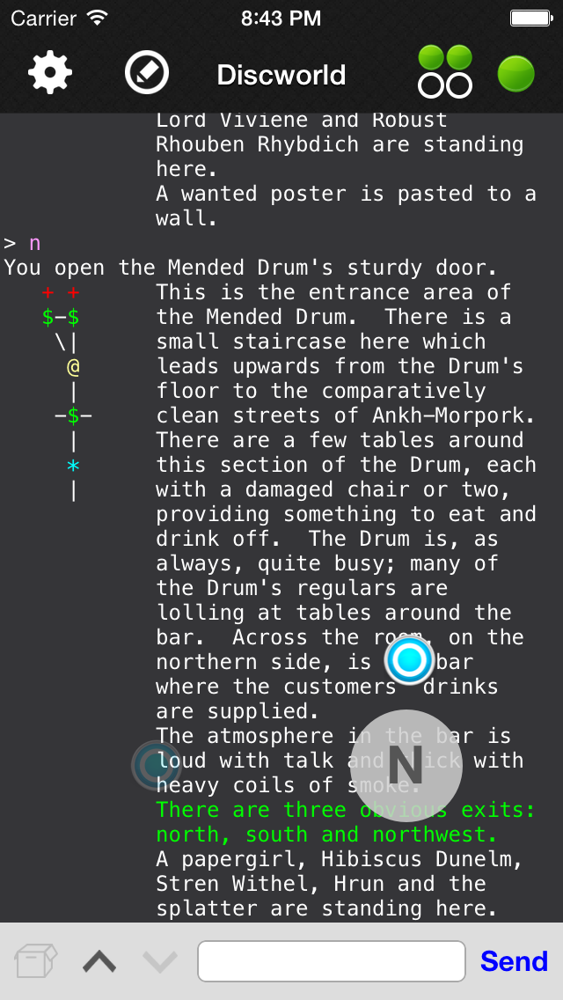

# MUDRammer — A Modern MUD Client

[](https://itunes.apple.com/us/app/mudrammer-a-modern-mud-client/id597157072?mt=8)

```
> invoke incantation of build status divination

You move a hand through a series of quick gestures, 
your digits twinkling with eldritch potential. 
Suddenly, some images form in your mind:
```

[](https://circleci.com/gh/splinesoft/MUDRammer) [](http://codecov.io/github/splinesoft/MUDRammer?branch=master)  [](http://getlamp.com)

<hr/>

MUDRammer is a modern MUD client for iPhone and iPad focused on speed, accessibility, and flexibility. MUDRammer has been designed and developed by [Jonathan Hersh](#contact) since November 2012. MUDRammer's first App Store release in February 2013 was followed by [34 App Store updates](https://github.com/splinesoft/MUDRammer/blob/master/AppStore/updates.txt) as of May 2015 and an open-sourcing in June 2015.

[MUDs (Multi-User Dungeons)](https://en.wikipedia.org/wiki/MUD) are online multiplayer text-based games. Thousands of players today are on hundreds of MUDs in all manner of worlds: fantasy, absurdist, sci-fi, horror, and more. Many MUDs have been continuously online for decades! MUDRammer includes a `DefaultWorlds.plist` with a few interesting default worlds you can try, or you can add your own.

MUDRammer is available for sale on the [App Store](https://itunes.apple.com/us/app/mudrammer-a-modern-mud-client/id597157072?mt=8). Although this repository will allow you to build and run MUDRammer from source, please purchase [MUDRammer on the App Store](https://itunes.apple.com/us/app/mudrammer-a-modern-mud-client/id597157072?mt=8) to support continued development.

[](https://itunes.apple.com/us/app/mudrammer-a-modern-mud-client/id597157072?mt=8)

## For Your Eyes Only

MUDRammer has been my personal passion project for years. It is an experiment to release my work under such a permissive license. If you use MUDRammer, please purchase a copy from the [App Store](https://itunes.apple.com/us/app/mudrammer-a-modern-mud-client/id597157072?mt=8) rather than running it from source. If you want to create your own software based on MUDRammer, please make it meaningfully different and not just a clone. Please do not submit your own version of MUDRammer to the App Store.

## Getting Started

This checkout contains a compatibility update targeting **iOS 15 and later**.
Use a Mac with a current full Xcode installation and an iOS Simulator runtime.
The update still requires compilation and device verification on a Mac.

1. Copy this updated checkout to your Mac.
2. From the project folder, run `bash scripts/build-ios.sh` to prepare the bundled
   dependencies and build for the simulator.
3. Run `bash scripts/build-ios.sh test` to run the existing unit tests.
4. Open `src/Mudrammer.xcworkspace` and select **MUDRammer Dev**. For a physical
   iPhone, choose your own development team and a unique bundle identifier under
   the app target's **Signing & Capabilities**, then select the phone and Run.

See [the Mac setup and verification guide](docs/MODERN_IOS.md) for complete
instructions, changes, and remaining validation. The build uses checked-in
dependencies; do not run the historical `rake setup` or `pod install` commands.

## Notes

- The app and bundled dependency projects target iOS 15 and later. The historical
  Ruby dependency setup is retained for reference.
- Version and build numbers come from the `MARKETING_VERSION` and
  `CURRENT_PROJECT_VERSION` build settings.
- HockeyApp and UserVoice are removed from the build. iCloud theme sync is off
  by default; local preferences work without the original developer's account.
- MUDRammer has a separate app icon to distinguish Debug builds, [no code required!](http://list.her.sh/beta-app-icons)

## Contributing

Pull requests are welcome! Fork the repo and make your changes on a branch. Run
`bash scripts/build-ios.sh test` on a Mac before opening a pull request.

## License

MUDRammer's source code is available under the MIT license. See the `LICENSE` file for more details.

Although technically permitted by the license terms, please do not submit your own version of MUDRammer to the App Store.

Fonts, images, and sounds bundled with MUDRammer are licensed free for commercial use.

## About the Name

I've been very fortunate in my years of mudding to have met people from all over the world. One of my more colorful Dutch mudding acquaintances has played for years with a character named "Mudrammer". It is a ridiculous and silly name, but it still makes me :laughing:

## Contact

Jonathan Hersh

- [Electronic Mail](mailto:jon@her.sh)
- **@jhersh** on [Github](https://github.com/jhersh) and [Twitter](https://twitter.com/jhersh)
- [her.sh](http://her.sh)
